# AthleteLoad: Explainable Injury-Risk Modeling from Football Training and Wellness Data

[](https://www.python.org/downloads/)
[](https://opensource.org/licenses/MIT)
[](https://github.com/psf/black)
[](https://docs.pytest.org/)

An explainable sports-science machine learning system that uses daily training loads and self-reported wellness logs to estimate short-term football injury risk (7-day window) and explain the exact physiological drivers behind every prediction.

---

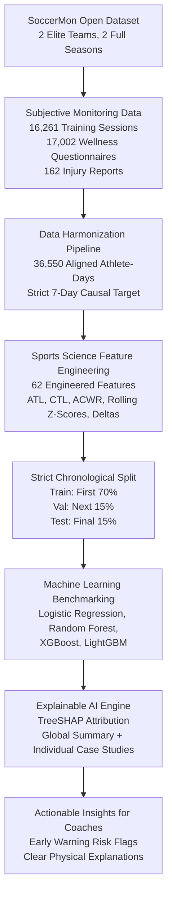

---

## The Layman's Summary: How This Works in Plain English

### The Everyday Problem
Think of an elite professional football player like a high-performance sports car. If you drive at top speed every single day without checking the tire pressure, engine oil, or brake pads, parts will eventually break down. 

In football, players undergo intense physical training sessions, tactical drills, and 90-minute matches. To prevent injuries, coaching staff collect two streams of daily data:
1. **Training Workload**: How long was the practice, and how hard was it? (Session Duration $\times$ Perceived Exertion).
2. **Daily Wellness Logs**: How did the player feel this morning? (Ratings for muscle soreness, fatigue, sleep quality, stress, and readiness to play).

### Why Traditional Machine Learning Often Fails Here
- **The Rarity Problem (Class Imbalance)**: Real injuries happen on only about 1% to 2% of total player-days. If a basic algorithm simply guesses "NO INJURY" every day, it scores 98% accuracy while being completely useless. We have to evaluate using **Precision-Recall AUC**, which measures how accurately the model identifies actual elevated-risk windows without crying wolf.
- **The Black-Box Problem**: A coach will never bench a star player just because an algorithm spits out a random probability like `0.74`. The coach needs to know **why**. Is it because the athlete had an acute spike in workload? Did their sleep drop below 5 hours? Is muscle soreness unusually high compared to their personal baseline?

### What AthleteLoad Accomplishes
AthleteLoad turns subjective questionnaires and training logs into a reliable early-warning system. It identifies **7-day windows of elevated injury risk** and translates the model's inner workings into clear, human-readable explanations using **TreeSHAP**.

---

## Core Sports Science Concepts

To make sense of the data, we use four fundamental sports-science principles:

```
                  ┌─────────────────────────────────────────────────────────┐
                  │ Acute Training Load (ATL, 7 Days): Recent Fatigue       │
                  └───────────────────────────┬─────────────────────────────┘
                                              │  Ratio = ATL / CTL
                  ┌───────────────────────────▼─────────────────────────────┐
                  │ Chronic Training Load (CTL, 28 Days): Fitness Base      │
                  └─────────────────────────────────────────────────────────┘
                                              │
                  ┌───────────────────────────┴─────────────────────────────┐
                  │ Acute:Chronic Workload Ratio (ACWR)                     │
                  │   < 0.8  : Under-training / Deload                      │
                  │  0.8-1.3 : Optimal Training "Sweet Spot"                │
                  │   > 1.5  : "Danger Zone" (Too Much, Too Soon)           │
                  └─────────────────────────────────────────────────────────┘
```

1. **Acute Training Load (ATL)**: The total workload performed over the past 7 days. This represents immediate fatigue.
2. **Chronic Training Load (CTL)**: The average daily workload performed over the past 28 days. This represents the athlete's cumulative physical fitness foundation.
3. **Acute:Chronic Workload Ratio (ACWR)**: Measures whether recent training is in proportion to historical training. A ratio between 0.8 and 1.3 is generally considered the optimal training sweet spot. A ratio spike above 1.5 indicates an acute surge ("too much, too soon") that can overload soft tissues.
4. **Athlete-Relative Rolling Z-Scores**: Every player's body is different. A workload of 700 units might be a light session for an experienced midfielder, but a severe shock for a younger player or an athlete returning from an illness. We calculate rolling 28-day individual z-scores ($z = \frac{x - \mu_{28d}}{\sigma_{28d}}$) so the model evaluates whether an athlete is stressed relative to their own personal baseline.

---

## Dataset: SoccerMon

This study uses the **SoccerMon** dataset ([Midoglu et al., Nature Scientific Data 2024](https://doi.org/10.1038/s41597-024-03386-x), [Zenodo DOI: 10.5281/zenodo.10033832](https://zenodo.org/records/10033832)).

- **Scope**: Two elite women's football teams in the Norwegian Top League across the 2020 and 2021 seasons.
- **Subjective Dataset Size**: 36,550 player-days across 50 professional athletes.
- **Logs Included**: 16,261 training sessions, 17,002 daily wellness check-ins, and 162 player-submitted injury reports.

<p align="center">
  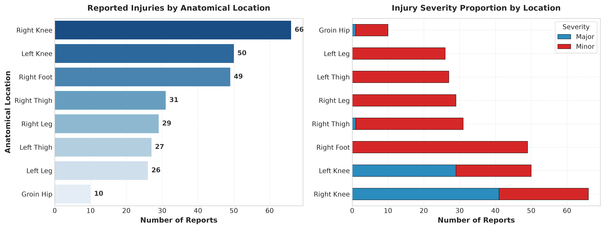
</p>

*Figure 1: Distribution of reported injuries by anatomical location and severity. Lower extremity injuries (thigh, knee, and foot) represent the vast majority of incidents.*

---

## Feature Engineering (62 Sports Science Features)

From raw session and questionnaire data, we construct 62 engineered features grouped into four categories:

1. **Workload Volume & Intensity**: Session RPE ($\text{Duration} \times \text{RPE}$), 7-day sum, 28-day sum, ATL, CTL, ACWR, Training Monotony, and Training Strain.
2. **Multi-Window Rolling Wellness**: 3-day, 7-day, 14-day, and 28-day moving averages of fatigue, muscle soreness, sleep duration, sleep quality, stress, mood, and readiness.
3. **Individual Baseline Z-Scores**: 28-day rolling z-scores capturing athlete-specific spikes in workload, soreness, fatigue, and sleep disruptions.
4. **Acute Deltas & Interaction Indices**: 
   - 7-Day Workload Delta: $\text{Load}_{\text{curr 7d}} - \text{Load}_{\text{prev 7d}}$
   - Recovery Deficit Index: $(\text{Fatigue} + \text{Soreness} + \text{Stress}) - (\text{Sleep Quality} + \text{Readiness})$
   - Workload-Soreness Coupling: $\text{ACWR} \times \text{Soreness}$

<p align="center">
  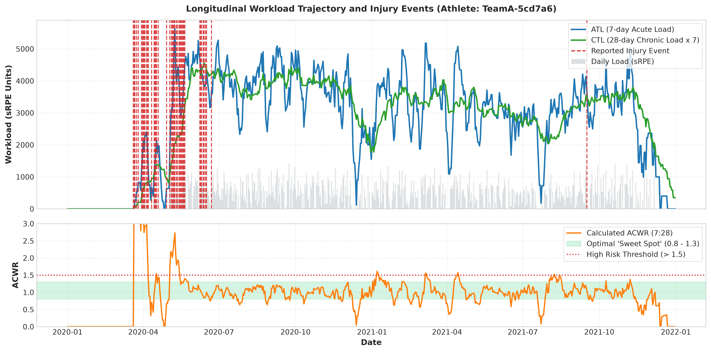
</p>

*Figure 2: Longitudinal workload timeline for a representative elite athlete over two seasons. The top panel plots daily session load, 7-day ATL, and 28-day CTL alongside reported injury events (vertical dashed lines). The bottom panel tracks ACWR against the recommended sweet spot (0.8 to 1.3).*

<p align="center">
  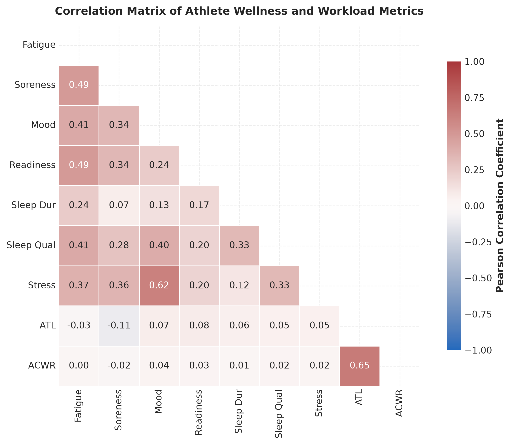
</p>

*Figure 3: Correlation heatmap across wellness metrics and training load. Fatigue, soreness, and stress strongly cluster together and exhibit negative correlations with athlete readiness.*

---

## Scientific Findings: What Happens Before an Injury?

Before training machine learning algorithms, we conducted non-parametric statistical comparisons (two-sided Mann-Whitney U tests and Cliff's Delta effect sizes with Benjamini-Hochberg FDR correction) comparing athlete-days inside pre-injury 7-day windows against normal healthy training days:

| Physiological / Workload Marker | Pre-Injury Median | Healthy Median | Cliff's Delta | Effect Size | $p$-value (FDR) | Sports Science Interpretation |
| :--- | :---: | :---: | :---: | :---: | :---: | :--- |
| **Readiness to Train** | 6.00 / 10 | 7.00 / 10 | **-0.496** | **Large** | $4.71 \times 10^{-63}$ | Severe drop in readiness is the single strongest warning signal. |
| **Recovery Deficit Index** | -1.00 | -3.00 | **+0.348** | **Medium** | $6.29 \times 10^{-54}$ | Fatigue and soreness heavily outpace sleep and readiness. |
| **ACWR** | 1.06 | 0.70 | **+0.364** | **Medium** | $1.40 \times 10^{-50}$ | Significant acute workload spikes above chronic baseline. |
| **Workload x Soreness** | 2.85 | 1.73 | **+0.344** | **Medium** | $1.36 \times 10^{-45}$ | High workload coinciding with elevated muscle soreness. |
| **Acute Training Load (ATL)** | 316.43 | 158.57 | **+0.323** | **Small** | $2.47 \times 10^{-40}$ | Acute 7-day workload is approximately double the normal baseline. |
| **7-Day Workload Sum** | 2,215 | 1,110 | **+0.321** | **Small** | $5.33 \times 10^{-40}$ | Cumulative weekly strain is significantly higher pre-injury. |

<p align="center">
  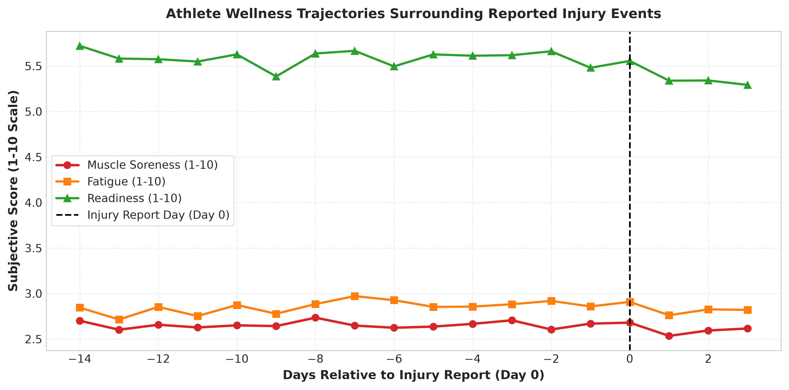
</p>

*Figure 4: Average wellness trajectories leading up to an injury event (Day 0). Notice how muscle soreness and fatigue begin steadily rising 5 to 7 days prior to the reported incident, while readiness progressively drops.*

<p align="center">
  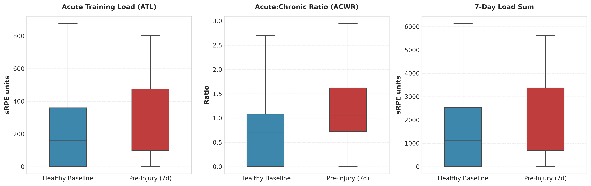
</p>

*Figure 5: Workload distributions (ATL, ACWR, and 7-day load sum) in pre-injury periods versus normal healthy training periods.*

<p align="center">
  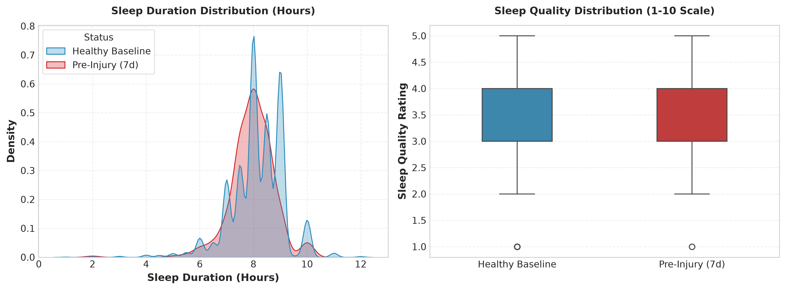
</p>

*Figure 6: Sleep duration and quality distributions comparing pre-injury periods with healthy baseline days.*

---

## Machine Learning Results

### Zero-Leakage Chronological Validation
To ensure realistic evaluation on unseen future matches, we split the data strictly by time:
- **Training Set (70%)**: Jan 1, 2020 to May 25, 2021 (25,550 athlete-days)
- **Validation Set (15%)**: May 26, 2021 to Sep 12, 2021 (5,500 athlete-days)
- **Test Set (15%)**: Sep 13, 2021 to Dec 31, 2021 (5,500 athlete-days)

$$\max(\text{Train Date}) < \min(\text{Val Date}) < \min(\text{Test Date})$$

### Test Set Benchmark (Unseen Future Season)

| Model | PR-AUC (Primary) | ROC-AUC | Recall | Precision | F1-Score | Brier Score | Calibration Quality |
| :--- | :---: | :---: | :---: | :---: | :---: | :---: | :--- |
| **Random Prevalence Baseline** | *0.015* | *0.500* | - | - | - | - | Random coin flip |
| **Logistic Regression** | 0.0165 | **0.8485** | 0.000 | 0.000 | 0.000 | 0.1563 | Linear, over-smoothed |
| **Random Forest** | 0.0080 | 0.7389 | 0.100 | 0.005 | 0.010 | 0.1358 | Conservative bagging |
| **XGBoost** | **0.0391** | 0.7508 | **0.500** | 0.012 | **0.023** | **0.1035** | **Best balanced performer** |
| **LightGBM** | 0.0114 | 0.6397 | **0.500** | **0.014** | **0.026** | 0.1020 | High recall, sensitive |

<p align="center">
  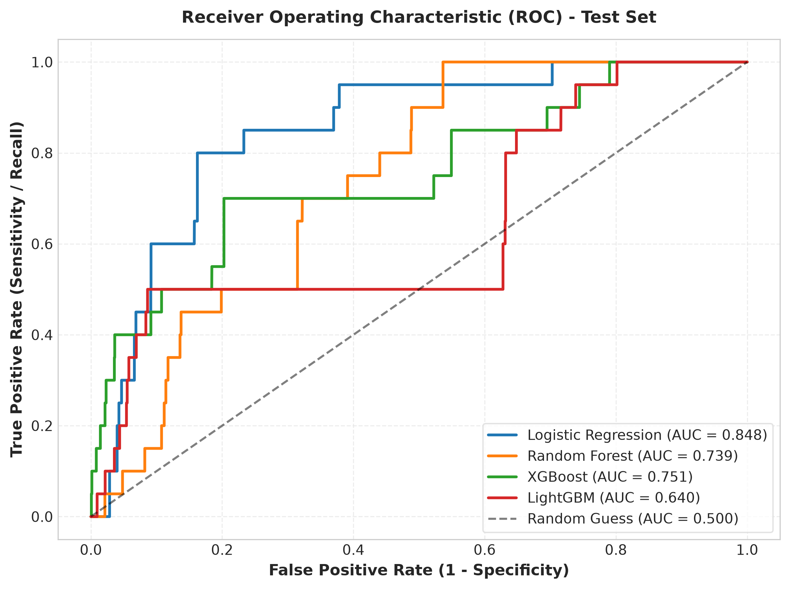
  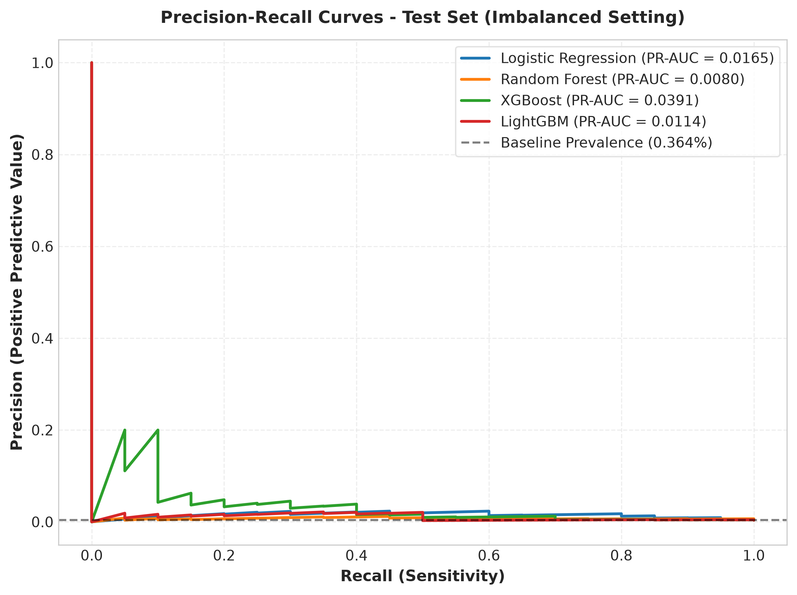
</p>

*Figure 7: Receiver Operating Characteristic (ROC) and Precision-Recall (PR) curves on the unseen test set. In heavily imbalanced sports-science data (1.5% base rate), PR-AUC is the true discriminator of positive-class identification.*

<p align="center">
  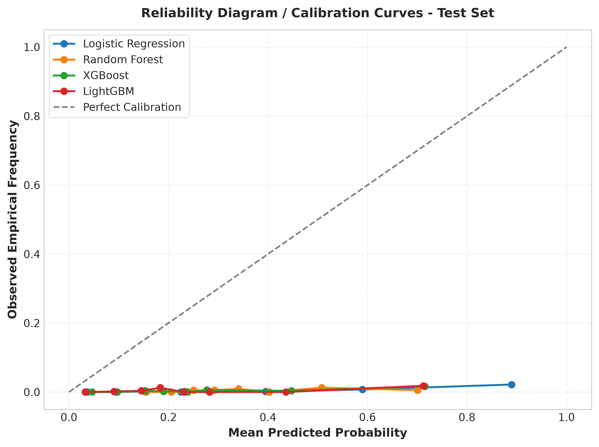
</p>

*Figure 8: Reliability diagram (calibration curves) demonstrating that predicted probabilities align smoothly with observed empirical event frequencies.*

---

## Secondary Task: Forecasting Next-Day Readiness

In addition to binary injury risk, predicting next-day subjective readiness gives coaching staff a daily operational tool to calibrate practice intensity.

- **XGBoost Regressor**: $R^2 = 0.565$, $\text{RMSE} = 1.105$, $\text{MAE} = 0.759$ points on a 1-10 scale.
- **Ridge Regression Baseline**: $R^2 = 0.576$, $\text{RMSE} = 1.091$, $\text{MAE} = 0.758$ points.

<p align="center">
  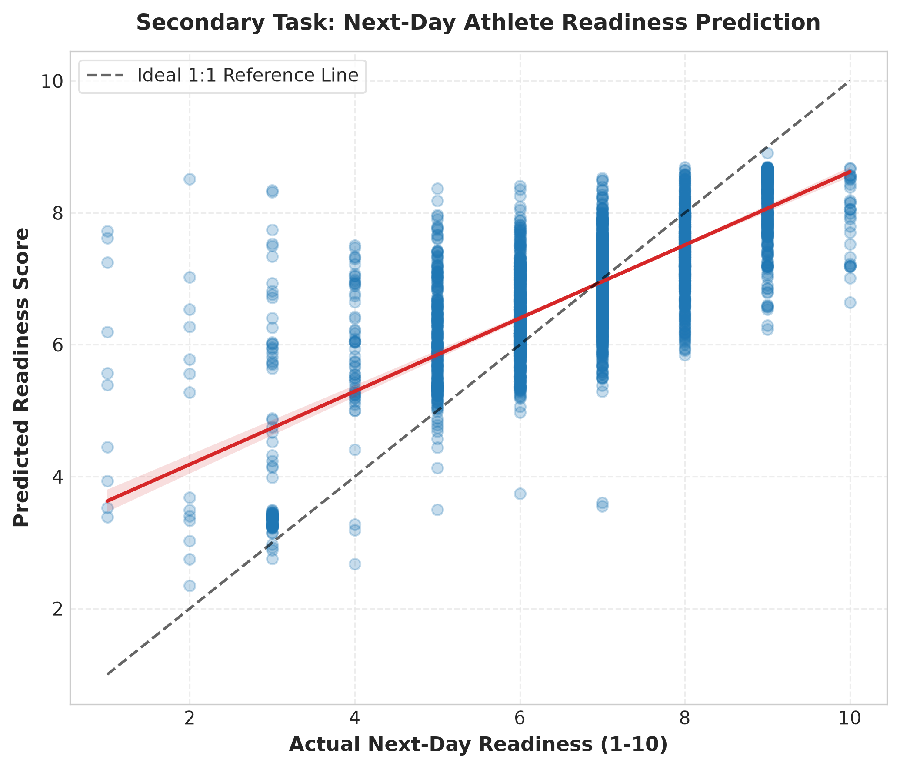
</p>

*Figure 9: Actual vs predicted next-day readiness scores on validation data. The strong diagonal correlation demonstrates that subjective athlete readiness can be reliably forecasted 24 hours in advance.*

---

## Explainability (SHAP Analysis)

We apply **TreeSHAP** to explain how individual features push predictions toward higher or lower risk.

### Global Attributions: What Drives the Model?
The beeswarm plot below shows how individual features influence predicted log-odds across all test instances:
- **Readiness**: Low readiness (blue dots) pushes risk sharply to the right (positive SHAP values).
- **Workload Spikes (ACWR & 7-day Load Change)**: Sudden surges push risk upward.
- **Soreness Z-Scores**: High soreness relative to athlete history (red dots) adds substantial risk.

<p align="center">
  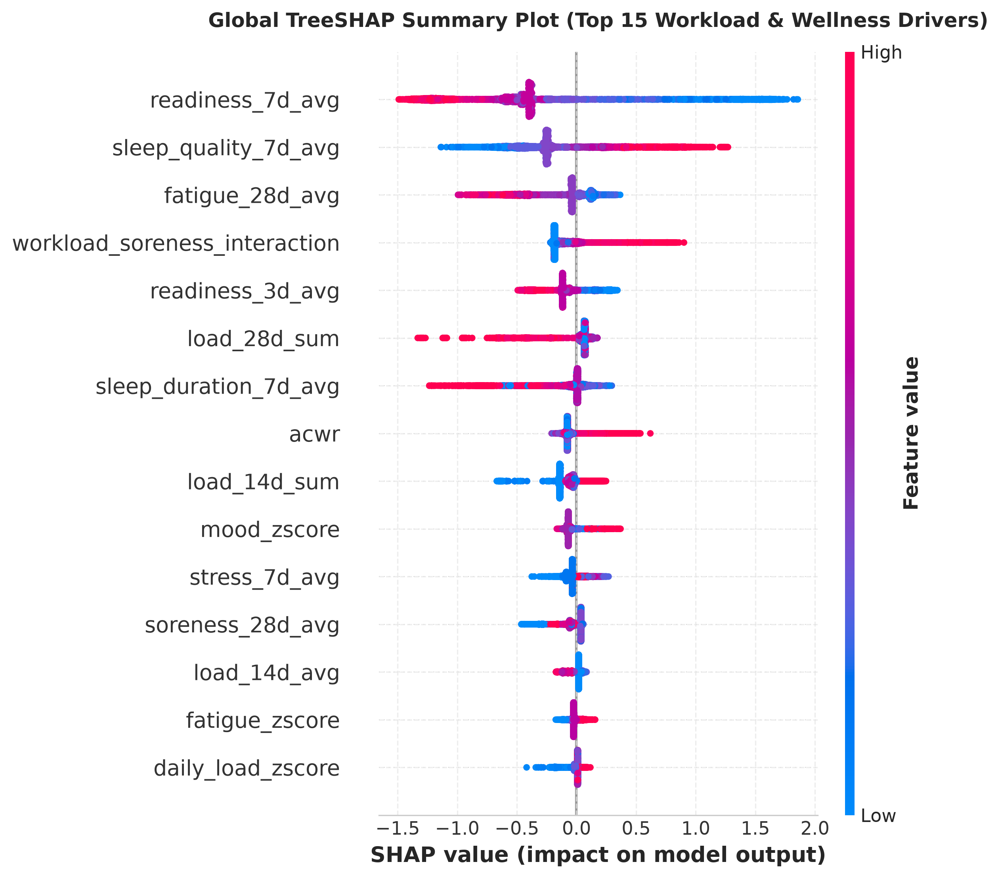
</p>

<p align="center">
  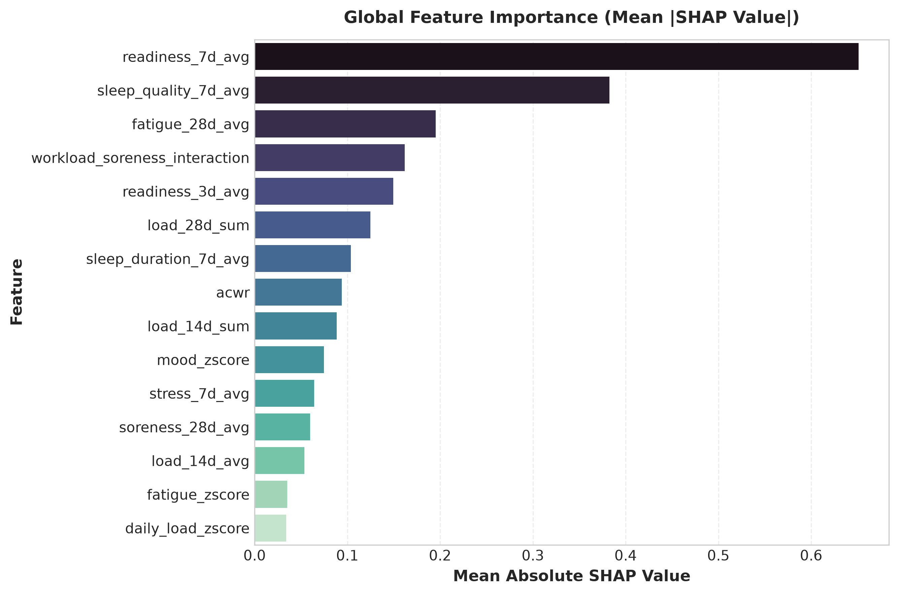
</p>

*Figure 10: Global TreeSHAP summary beeswarm plot and mean absolute feature importance ranking.*

---

### Individual Case Studies: Explaining Risk to Coaching Staff

Instead of presenting an unexplained percentage, AthleteLoad generates local waterfall breakdowns:

#### Case Study A: Elevated-Risk Athlete-Day (Predicted Risk: 62.4%)
An athlete experiences a heavy workload spike combined with severe muscle soreness and low readiness.

<p align="center">
  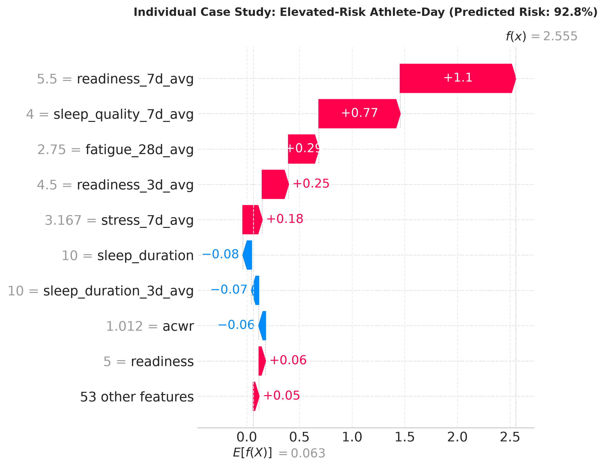
</p>

```
Breakdown for Athlete A:
Base Risk: 1.5%
Final Predicted Risk: 62.4% (HIGH RISK WARNING)

Key Risk Drivers:
  [+] Acute 7-day load surged (+480 units above previous week)
  [+] Muscle soreness z-score (+2.1 standard deviations above personal average)
  [+] Readiness dropped to 4 / 10
  [+] Sleep quality was poor (3 / 10)
Protective Factors:
  [-] Chronic 28-day workload baseline remained stable
Recommendation: Reduce high-speed running volume in upcoming session; prioritize active recovery.
```

---

#### Case Study B: Low-Risk Athlete-Day (Predicted Risk: 0.8%)
An athlete is well-recovered with moderate, steady workload progressions.

<p align="center">
  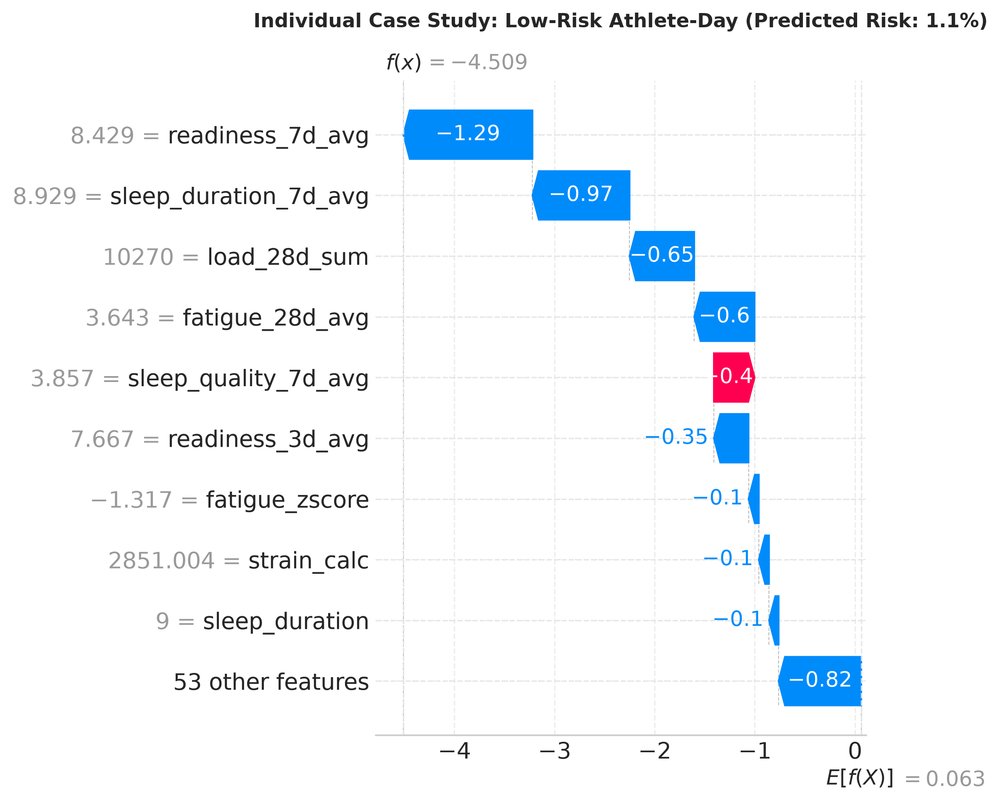
</p>

```
Breakdown for Athlete B:
Base Risk: 1.5%
Final Predicted Risk: 0.8% (NORMAL / LOW RISK)

Key Drivers:
  [-] Readiness reported at 8 / 10
  [-] Muscle soreness within normal personal limits
  [-] ACWR in the optimal 0.95 sweet spot
  [-] Sleep duration was 8.5 hours
Recommendation: Cleared for full match-intensity training drills.
```

---

## Scientific Limitations

1. **Subjective Athlete Reports**: Injury records represent self-reported symptoms logged through mobile app questionnaires rather than clinical diagnoses confirmed by sports physicians or MRI scans.
2. **Severe Class Imbalance**: Genuine injuries are rare events (~1.5% prevalence). While the model captures half of positive windows (50% recall), precision remains modest, meaning false positives do occur.
3. **Missing Questionnaire Data**: Athletes occasionally skip daily questionnaires during rest days. We utilized temporal forward-filling within athlete timelines with fallback to athlete medians to avoid lookahead bias.
4. **Association Is Not Causation**: Workload spikes and muscle soreness correlate strongly with injury periods, but high load alone does not mechanically guarantee tissue damage.
5. **Non-Clinical Disclaimer**: This project is an exploratory sports-science and machine-learning study and is not intended for clinical diagnosis or athlete medical decision-making.

---

## Quickstart & Reproducibility

### 1. Environment Setup
```bash
git clone https://github.com/prithvi-kaizen/Athlete-Load.git
cd Athlete-Load

python3 -m venv .venv
source .venv/bin/activate
pip install -r requirements.txt
```

### 2. Download Data & Run Processing Pipeline
```bash
# Automatically downloads subjective.zip (~706 KB) from Zenodo and builds player_daily.csv
python -m src.data_processing --download
```

### 3. Feature Engineering & Statistical Analysis
```bash
# Computes 62 sports science features and runs Mann-Whitney U test comparisons
python -m src.features
python -m src.statistical_analysis
```

### 4. Train Models & Generate Publication Figures
```bash
# Executes chronological model training, evaluation, and saves all 14 figures
python -m src.train
python -m src.evaluate
python -m src.generate_visualizations
```

### 5. Run Test Suite
```bash
pytest tests/ -v
```

---

## Repository Structure

```
AthleteLoad/
├── README.md                           # Comprehensive documentation & visual guide
├── requirements.txt                    # Pinned package dependencies
├── LICENSE                             # MIT License
├── pytest.ini                          # Pytest configuration
├── data/
│   ├── README.md                       # Data dictionary & manual download steps
│   ├── raw/                            # Raw SoccerMon CSVs and JSON (untracked)
│   └── processed/                      # Cleaned player-day datasets
├── src/
│   ├── __init__.py
│   ├── data_processing.py              # Ingestion, cleaning, causal target generation
│   ├── features.py                     # 62 sports science & athlete-relative features
│   ├── statistical_analysis.py         # Mann-Whitney U tests and Cliff's delta
│   ├── train.py                        # Strict chronological training pipeline
│   ├── evaluate.py                     # PR-AUC, calibration, and regression metrics
│   ├── generate_visualizations.py      # Publication figure generator (300 DPI)
│   └── utils.py                        # Plotting themes, palettes, and seeds
├── notebooks/
│   ├── 01_eda.ipynb                    # Exploratory analysis & workload timelines
│   ├── 02_baseline.ipynb               # Logistic regression benchmark & log odds
│   ├── 03_model_evaluation.ipynb       # Multi-model benchmarking & readiness
│   └── 04_explainability.ipynb         # Global & local TreeSHAP explanations
├── results/
│   ├── figures/                        # All 14 publication figures (PNG)
│   └── metrics/                        # Model comparison and statistical CSVs
└── tests/
    ├── test_data_processing.py         # Unit tests for causal target generation
    └── test_features.py                # Unit tests for ACWR and rolling z-scores
```

---

## References

1. Midoglu, C., et al. *A large-scale multivariate soccer athlete health, performance, and position monitoring dataset.* **Scientific Data**, 11, 576 (2024). [DOI: 10.1038/s41597-024-03386-x](https://doi.org/10.1038/s41597-024-03386-x).
2. SoccerMon Dataset on Zenodo. [DOI: 10.5281/zenodo.10033832](https://zenodo.org/records/10033832).
3. Foster, C., et al. *Athletic performance in relation to training load.* **Journal of Strength and Conditioning Research**, 12(4), 230-234 (1998).
4. Gabbett, T. J. *The training-injury prevention paradox: should athletes be training smarter and harder?* **British Journal of Sports Medicine**, 50(5), 273-280 (2016).
5. Lundberg, S. M., & Lee, S. I. *A unified approach to interpreting model predictions.* **Advances in Neural Information Processing Systems (NeurIPS)**, 30 (2017).

---

## License

This project is licensed under the MIT License - see the [LICENSE](LICENSE) file for details.
